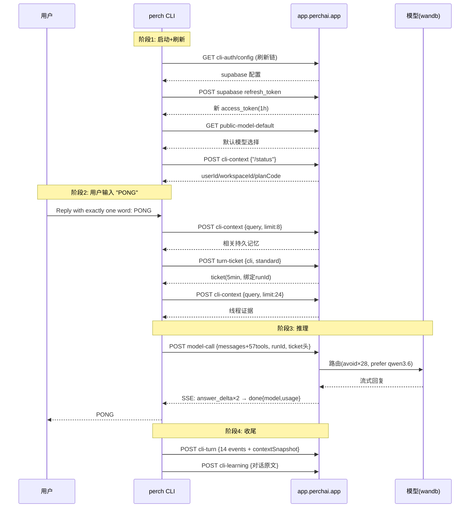

# Perch CLI 从登录到对话：完整生命周期（逆向 + 实测双证）

> 证据链：静态逆向 `dist/perch.mjs` + Python 复刻端到端验证 + 蜜罐真实捕获（`logs-run1/2/3/5` + `logs` 共 5 个日志目录，累计 38 条请求捕获，全部 200）
> 整理日期：2026-10-13
> 本文是全部研究的总纲，一切细节以本文为准

---

## 总览：五个阶段

```
阶段 0  登录（一次性）          OAuth2 + PKCE → 会话落盘
阶段 1  启动（每次运行）        会话加载 → 刷新 → 环境注入
阶段 2  对话准备（每轮）        记忆检索 → 领票
阶段 3  推理循环（每轮×N迭代）  model-call → 工具执行 → 回传
阶段 4  收尾（每轮）            遥测 → 训练采样 → 持久化
```

---

## 阶段 0：登录（`perch login`）

### 0.1 流程（已被 Python 复刻端到端验证）

```
CLI                                        Perch 服务端
───                                        ────────────
1. GET /api/perch-terminal/cli-auth/config
   （公开端点，无需认证）        ────────→  返回 supabaseUrl + anonKey +
                                           providers[] + redirectHost
2. 本地起回调服务器
   http://127.0.0.1:<随机端口>/callback
   （120s 超时）

3. 生成 PKCE
   verifier  = 随机 64 字节 base64url
   challenge = SHA256(verifier) base64url

4. GET {supabase}/auth/v1/authorize
   ?provider=google|github
   &redirect_to=<本地回调>
   &code_challenge=…&code_challenge_method=s256
   [&prompt=select_account]      ← 仅 Google
                                 ────────→  302 到 Google/GitHub 授权页
5. 打开浏览器（open/xdg-open/start）
   ← 用户完成授权 →

6. Google → Supabase /auth/v1/callback → 302 回本地
   /callback?code=<auth_code>

7. POST {supabase}/auth/v1/token?grant_type=pkce
   {auth_code, code_verifier}    ────────→  返回 access_token(1h) +
                                           refresh_token + user
8. （可选）user_metadata.signup_source 为空时
   PATCH {supabase}/auth/v1/user
   {data:{signup_source:"cli"}}   ← 一次性渠道归因标记

9. 会话落盘
   macOS: Keychain app.perchai.cli-auth/default
   其他:  ~/.perch/cli-auth-session.json (0600)
```

### 0.2 会话结构（v1）

```json
{
  "version": 1,
  "appUrl": "https://app.perchai.app",
  "accessToken": "<JWT, 1403 字符, 1 小时>",
  "refreshToken": "<…>",
  "expiresAt": <unix 秒>,
  "userId": "<uuid>",
  "email": "<…>",
  "updatedAt": "<ISO>"
}
```

**JWT claims**：`sub`(用户) `session_id` `role:"authenticated"` `aal:"aal1"` `user_metadata.signup_source:"cli"`

### 0.3 关键安全设计

- **PKCE 防拦截**：verifier 只在 CLI 内存，从不出现在浏览器链路
- **随机端口回调**：只有本机可达
- **90 秒过期余量**：距过期 <90s 即视为需刷新

---

## 阶段 1：启动（每次 CLI 运行）

### 1.1 进程链

```
bin/perch
  ├─ 读 package.json → 设置 PERCH_CLI_VERSION=<真实版本>
  ├─ re-exec: node --max-old-space-size=4096 dist/perch.mjs
  │   （子进程继承全部环境变量）
  └─ 子进程加载 perch.mjs → 交互/单次模式
```

### 1.2 会话加载与刷新（实测捕获：run2 第一个请求就是刷新链）

```
1. 读会话（Keychain 或文件）
2. 若距过期 <90s（或强制）：
   a. 跨进程锁 ~/.perch/cli-auth-refresh.lock（防并发刷新）
   b. 失效缓存检查 ~/.perch/cli-auth-refresh.invalid.json
      （被吊销 token 的 SHA-256，24h TTL）
   c. GET /api/perch-terminal/cli-auth/config   ← 重新拿 anonKey
   d. POST {supabase}/auth/v1/token?grant_type=refresh_token
      {refresh_token}                            ← 换新 access_token
   e. 写回存储（token 轮换：refresh_token 也更新）
   f. 失败退避 30s；若 refresh_token 被吊销 → 清除本地会话
```

### 1.3 环境注入（供推理通道使用）

```
process.env.PERCH_MODEL_CALL_PROXY_URL   = appUrl
process.env.PERCH_MODEL_CALL_PROXY_TOKEN = accessToken
```

### 1.4 启动期请求（实测）

| # | 请求 | 用途 | 实测耗时 |
|---|---|---|---|
| 1 | `GET cli-auth/config` | 刷新链的一环 | 0.9s |
| 2 | `GET public-model-default` | 服务端默认模型选择 | 0.8s |
| 3 | `POST cli-context {query:"/status", limitPerScope:1}` | 探测 workspace + 记忆可用性 | 1.2s |

> 实测修正：`/status` 探测（`limitPerScope:1`）只在无线程历史的首次运行（run1）出现；run2 及以后启动期只有 `cli-auth/config` + `public-model-default` 两条，随后直接进入记忆检索。

**`cli-context` 响应**（实测）：
```json
{"ok":true,
 "session":{"userId":"…","workspaceId":"…","orgId":"…","planCode":"pro"},
 "permanentMemories":[],"attachments":[]}
```

**注意**：workspace 由 Web 应用首次登录创建；CLI 只读。无 workspace 时一切 hosted 功能返回 `workspace_required`。

---

## 阶段 2：对话准备（每轮）

### 2.1 用户输入 → 线程绑定

```
threadId = "cli-cwd-" + hash(cwd)     ← 同目录共享会话线程
历史消息从 ~/.perch/threads/<scopeHash>/<threadId>.json 恢复
```

### 2.2 上下文组装（contextSnapshot 实测结构）

| section | 实测 tokens | 说明 |
|---|---|---|
| system | 7,485 | Saffron 身份 + 验证契约 + 产品事实 + 能力声明 |
| tools | 12,426 | 57 个工具的 JSON Schema（**占 45%，最大头**） |
| output_reserve | 4,000 | 输出预留 |
| selected_skills | 3,666 | 已加载技能全文（如 about-perch） |
| desktop | 210 | CLI 环境说明段 |
| project_memory | 102 | `.perch/memory/*.md` |
| messages | 41 | 对话历史 |

**上下文预算**：`effectiveLimit` 随模型/档位而变，不存在统一折扣或 180k 上限。实测两档：
- 默认 200k 窗口模型（run2/run3/run5）：`rawContextWindowTokens: 200000` → `effectiveLimitTokens: 180000`（90%）
- pin DeepSeek 的 1M 窗口轮次（logs）：`rawContextWindowTokens: 1000000` → `effectiveLimitTokens: 980000`（98%）

使用率 ≥75% warn、≥90% critical。

> 实测修正：原写 `min(模型窗口, 180k)`（200k 打 9 折）只对 200k 模型成立；1M 窗口实测 980k（98%），折扣率由模型决定。

### 2.3 记忆检索（两次 cli-context，实测）

```
第 1 次: {query: 用户输入, limitPerScope: 8}   ← 检索相关持久记忆
第 2 次: {query: 用户输入, limitPerScope: 24}  ← 检索更早对话的证据
```

### 2.4 领票（abuse gate 的核心）

```
POST /api/perch-terminal/turn-ticket
{surface:"cli", profile:"standard"|"flock"}
Headers: Authorization: Bearer … + User-Agent: perchai-cli/unknown（两端点都带 UA，与 model-call 相同）

响应（实测）:
{ok, ticket, ticketId, runId, surface, profile, enforced, expiresAt}
```

**票据结构（实测解码）**：
```
ticket = base64url(payload) + "." + <32 字节 HMAC>
payload = {
  tid:  <ticket uuid>,
  uid:  <user>,
  wid:  <workspace>,
  surface: "cli",
  plan: "pro",              ← 套餐写进票据
  run:  "tkt-cli-<ts>-<rand>",  ← 绑定 runId（一次性）
  exp:  <unix 秒>            ← 实测 5 分钟有效
}
```

**客户端生命周期**：剩余 >30s 直接用；否则用 renewal 续期；无票时 hosted 调用被服务端拒（`not_authorized`）。

**runId 约定**：`tkt-cli-<epoch_ms>-<6位随机>`，由票据签发，贯穿整轮（model-call/cli-turn/cli-learning 全部复用）。

---

## 阶段 3：推理循环（每轮 × 最多 N 迭代）

### 3.1 请求构造（实测确认）

```
POST /api/perch-terminal/model-call
Headers:
  Content-Type: application/json
  Accept: text/event-stream          ← 流式
  Authorization: Bearer <access>
  User-Agent: perchai-cli/<版本>     ← gate 校验项（实测接受 unknown）
  x-perch-turn-ticket: <ticket>      ← 阶段 2 领的票

Body:
{
  request: {
    messages: [system(51k字符), …历史, 本轮输入],
    tools: [57 个工具 Schema],
    temperature: 0.6,
    maxTokens: 32000,
    toolChoice: "auto" | "required"   ← 停滞时强制 required
  },
  runId: <票据里的 runId>,
  lane: "chat",
  strictManual: false,
  preferredModelId: <Roost 偏好>,
  avoidModelIds: [历史失败模型],        ← 实测 28 个
  attribution: {userId, workspaceId, runId, lane, source:"cli", billingMultiplier},
  clientSurface: "cli",
  // 条件字段: roostModelChoice/effort/byo*/manualModelOptionId…
}
```

### 3.2 SSE 响应（实测事件）

```
data: {"type":"answer_delta","text":"P"}
data: {"type":"answer_delta","text":"ONG"}
data: {"type":"done","ok":true,"text":"PONG",
       "provider":"perch","model":"poolside/laguna-s-2.1",
       "durationMs":2874,
       "usage":{"inputTokens":18878,"outputTokens":3,
                "cacheReadInputTokens":7776,"totalTokens":26657}}
```

> 实测修正：上面是 run2（runId `tkt-cli-1791882578713-tl95b098`）的真实 done 事件。done 里 `provider:"perch"` 搭 `model:"poolside/laguna-s-2.1"`；`wandb/Qwen3.6-35B-A3B` 只出现在 cli-turn 的 `contextSnapshot.modelId`（`provider:"wandb"`），是被路由/快照标记的模型，并非实际运行的模型。

**9 种事件**：`answer_delta` / `reasoning_delta` / `tool_call_delta` / `tool_use_end` / `stream_restart`（工具中途故障转移）/ `continuation_seam` / `model_call_failed` / `done` / `error`

### 3.3 工具执行循环

```
done 带 toolCalls →
  权限检查（default: write/command 需审批；plan: 全锁）→
  本地执行（bash/文件/沙箱…）→
  追加 messages:
    {role:"assistant", content:"", tool_calls:[{id,type:"function",
      function:{name, arguments:JSON.stringify(input)}}]}
    {role:"tool", content:result, tool_call_id:id}
  → 回到 3.1（同一 runId，票据仍有效）
无 toolCalls → 循环结束
```

**重试**：408/425/5xx 重试 3 次（退避 350ms×2^n）；401 自动同步会话后重试一次。

**路由失败处理**：连续参数失败 ≥2 次 → 该模型进 avoidModelIds（服务端重新路由）。

### 3.4 compaction（逼近上限时）

```
剪枝 browser/screenshot 载荷 → 摘要旧轮次 → 丢弃最旧
（821 行编排器 prepareLoopMessagesForSend；决策点不在 autoCompact.ts）
```

---

## 阶段 4：收尾（每轮）

### 4.1 cli-turn（遥测，12s 超时，20s 节流）

```
POST /api/perch-terminal/cli-turn
{
  prompt, assistantText, threadId, runId,
  chatMode:"agents", personaId:"saffron",
  status:"completed"|"failed"|"cancelled"|"partial"|"blocked",
  durationMs, error, 
  events: [14 种事件：turn_started/context_summary/progress_*/
           model_call_*/content_delta/assistant_response/turn_completed],
  contextSnapshot: {完整上下文构成 + 用量 + 路由信息},
  systemInitiated: false, attachments: []
}
前置条件：userId + workspaceId 必须存在
```

### 4.2 cli-learning（训练采样）

```
POST /api/perch-terminal/cli-learning
{userMessage, assistantText, status, personaId, threadId, runId}
→ 服务端返回 {ok, admitted}（采样计数）
受 workspace.learning_consent 控制（服务端判断）
```

### 4.3 Supabase 直写（有 workspace 时）

```
perch_ai_messages / perch_ai_tool_calls / perch_ai_context_snapshots
（客户端直连数据库，anon key + RLS，非走 API）
```

---

## 完整时序图（实测 run2，10 个客户端调用 12.5 秒）

> 实测修正：图中画出 10 个客户端调用（含刷新链与 `/status` 探测）；蜜罐 tap 只覆盖 `app.perchai.app`，run2 实际捕获 8 条请求、跨度 12.5 秒（supabase 刷新不在 tap 范围，`/status` 探测仅在无线程历史的首次运行出现）。



---

## 服务端在每个阶段能看到什么（隐私全景）

| 阶段 | 数据 | 说明 |
|---|---|---|
| 登录 | Google OAuth 身份 | 经 Supabase |
| 启动 | userId/workspaceId/plan | cli-context |
| 对话准备 | **用户输入原文** | 作为记忆检索 query |
| 推理 | **system prompt + 全部历史 + 57 工具 + 本轮输入 + 所有工具结果** | model-call 请求体 |
| 收尾 | **对话原文×2**（cli-turn + cli-learning）+ 完整事件流 | 遥测+采样 |
| 直写 | 消息/工具调用/上下文快照 | Supabase 表 |

**结论**：推理走服务端代理意味着**每轮全量上下文都在 Perch 侧**；`cli-learning` 再独立回传一份对话原文。工具读到的本地文件内容（tool result）随 model-call 上行。

---

## abuse 边界（官方立场 + 实测验证）

### 允许（本次全程采用）

- ✅ 官方 CLI/Desktop/Web 正常使用
- ✅ 本地旁路观测（蜜罐，字节级透明，26 项自测）

### 禁止（封号原因，官方邮件明示）

- ❌ 脚本持 token 直连 API（格式/版本/ticket 皆不符）
- ❌ 自制客户端、伪造 ticket、探测端点、认证绕过
- ❌ 再次违反 → **永久封禁**

### 关键闸门（逆向 + 实测双重确认）

```
JWT 有效 → workspace 存在 → 票据有效(5min, 绑 runId) → UA+Bearer 齐 → 放行
        ↘ 401 not_authenticated
                 ↘ 403 workspace_required
                          ↘ 401/403 not_authorized/not_authenticated
```

**实测证明**：官方 CLI 自己发的请求全部 200，蜜罐旁路零影响。

---

## 附录：三次证据源的交叉验证状态

| 结论 | 逆向 | Python 复刻 | 蜜罐实测 |
|---|---|---|---|
| 登录 PKCE 全流程 | ✅ | ✅ 端到端跑通 | ✅（token 有效） |
| 刷新链（config→refresh） | ✅ | ✅ | ✅ run2 首请求 |
| 票据 5 分钟有效期 | ⚠️(30s 续期阈值) | — | ✅ exp 字段 |
| 票据非标准 JWT | ❌ 曾误判 JWT | — | ✅ 32 字节 HMAC |
| runId 贯穿全轮 | ✅ | — | ✅ 三端点同值 |
| UA `perchai-cli/unknown` 可用 | ❌ 曾认为需版本 | — | ✅ 服务端 200 |
| 57 工具按 surface 裁剪 | ⚠️(134 全集) | — | ✅ 实测清单 |
| 上下文 45% 是工具 Schema | ✅ 逆向估算 | — | ✅ contextSnapshot |
| 缓存命中省 token | ✅ 设计存在 | — | ✅ 7,776 cacheRead |

---

*整理完成：2026-10-13 · 全程零违规网络行为（蜜罐透明性 26 项自测通过）*
